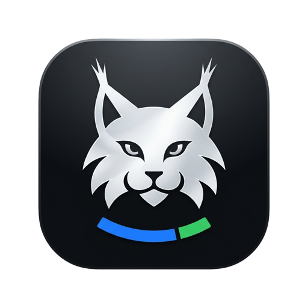
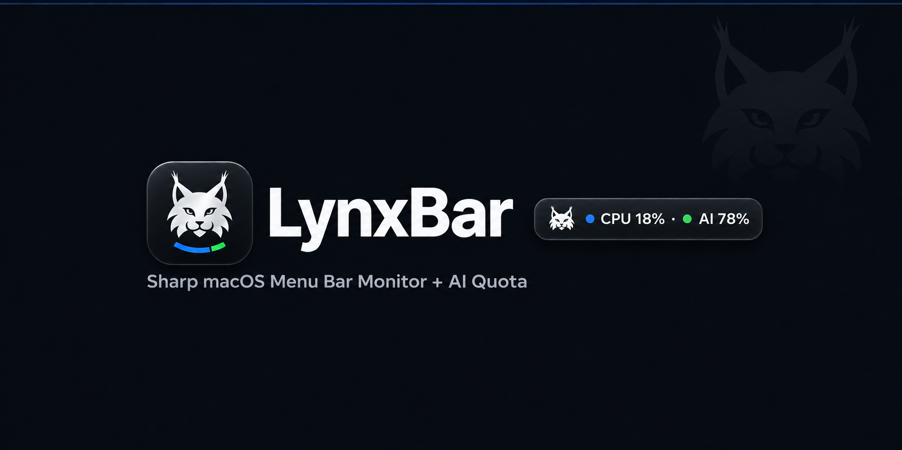

<p align="center">
  
</p>

<h1 align="center">LynxBar</h1>

<p align="center">
  <strong>Sharp, native, privacy-first macOS menu bar system monitor &amp; opt-in AI subscription quota tracker.</strong>
</p>

<p align="center">
  Built in Swift 6 (<code>complete</code> strict concurrency) with AppKit, SwiftUI, and <code>CodexBarCore</code> (MIT) for AI quota tracking.
</p>

<p align="center">
  <a href="https://github.com/swnb/lynxbar/actions/workflows/ci.yml"></a>
  
  
  
  <a href="https://github.com/swnb/lynxbar/releases"></a>
  <a href="./LICENSE"></a>
</p>

<p align="center">
  <strong>English</strong> · <a href="./README.zh-CN.md">简体中文</a>
</p>

<p align="center">
  <a href="#features">Features</a> •
  <a href="#privacy-commitments">Privacy</a> •
  <a href="#installation">Installation</a> •
  <a href="#architecture-highlights">Architecture</a> •
  <a href="#documentation--community">Docs</a>
</p>

<p align="center">
  
</p>

---

## Features

### Menu Bar & `420×600` Dashboard
- **Single Status Item (`LSUIElement`)**: Lives quietly in your menu bar with no Dock icon and three display modes:
  - **Minimal** — system health symbol only
  - **Focus** — 1 metric slot
  - **Compact** — up to 3 slots (defaults to `CPU`, `DSK`, `NET`)
- **9 Menu Bar Metric Slots**: `CPU`, `MEM` (Memory), `DSK` (Disk usage), `NET` (Network ↓/↑), `GPU`, `TMP` (System thermal state), `BAT` (Internal battery), `ACC` (Accessory battery), and `AI` (AI Quota).
- **Fixed `420×600` Panel**: Header with quick-access Settings gear (`⚙`), Overview + per-resource detail views, and customizable bottom navigation tabs.
- **Appearance Modes**: Choose **System** (default), **Dark**, or **Light** in Settings.

### System Monitoring
- **Overview**: Honest health evaluation (`Healthy` / `Attention` / `Critical` / `Collecting`), 60-second primary trend (`CPU`, `Memory`, or `Network`), top actionable `Attention` item, top 3 processes, and an optional compact `AI Quota` row when enabled.
- **CPU**: Total utilization, per-core bars, load averages (`1 / 5 / 15m`), uptime, thermal context, and top CPU processes.
- **Memory**: Event-driven macOS memory pressure (`DispatchSource.makeMemoryPressureSource`), active/wired/compressed breakdown, swap usage, and top memory processes.
- **Disk**: Root volume (`/`) capacity & low-frequency trends (`10 min` / `1 hour` / `1 day` cadence; `1h` / `1d` / `1w` ranges), mounted volumes, and Trash-safe cleanup.
- **Network**: Default-route primary physical interface (`SystemConfiguration` + `sysctl` 64-bit counters), download/upload rates, on-demand per-process attribution (`nettop`), primary private IP & MAC address, and opt-in Public IP lookup.
- **GPU**: Metal device info, hardware utilization, and thermal context.
- **Battery & Accessories**: Internal battery charge/health/power draw, plus `GameController` battery and opt-in standard Bluetooth Battery Service (`180F` / `2A19`) accessories.
- **Thermal & Processes**: Public `ProcessInfo.thermalState` monitoring and top `5–20` process list with guided `Quit` / `Force Quit` remediation.

### Trash-Safe Disk Cleanup
Launch **Review Files…** from the **Disk** panel to open the **LynxBar — Free Up Space Safely** window:
- **Narrow Scope**: Scans `Downloads` or a user-chosen folder while refusing volume roots, the home root (`~`), `~/Library`, symbolic links, `.app` bundles/packages, and non-local volumes.
- **Conservative Rules**: Flags only downloaded, non-hidden regular local files with hard-link count `1` that are either **Large** (`≥ 1 GiB`) or **Old & large** (`≥ 100 MiB` and unmodified for `≥ 90` days).
- **Safe Execution**: Zero items preselected, **All / Large / Old** filters, **Show in Finder**, explicit confirmation dialog, and per-item identity revalidation before moving files to macOS **Trash** (never permanently deleted).

### Opt-In Multi-Provider AI Subscription Quota (`AI Quota`)
- **Disabled by Default & Independent Opt-In**: **Claude**, **OpenAI Codex**, and **Antigravity** each have independent toggles defaulting to `false` in the **AI** tab and **Settings → Privacy** — zero credential reads or network requests occur for any disabled provider.
- **Powered by `CodexBarCore` (MIT) with Strict Privacy Boundaries**: Reuses upstream `CodexBarCore` provider pipelines with browser-cookie extraction explicitly disabled (`cookieSource = .off`):
  - **Claude**: OAuth-only via macOS Keychain `"Claude Code-credentials"` or `~/.claude/.credentials.json`.
  - **OpenAI Codex**: Local CLI / OAuth credentials (`$CODEX_HOME/auth.json` or `~/.codex/auth.json`).
  - **Antigravity**: Local Antigravity desktop app, IDE, or `agy` CLI session (replacing the sunset consumer Gemini CLI).
- **Simultaneous Multi-Entry Panel**: Displays an independent `V2Card` per enabled provider with plan/account badges, per-provider refresh, rolling/model windows (`5-hour session`, `7-day weekly`, `Code Review`, `Gemini Models`, `Claude and GPT`, model breakdowns), **Extra usage** (Claude), **Credits** (Codex), reset countdowns, and a **Left / Used** display toggle.
- **Menu Bar & Overview Integration**: Optional `AI` menu bar slot (shows the most-constrained fresh provider's percentage such as `AI 78%`, names all active providers in VoiceOver/tooltips, and falls back to `AI —` when off/unavailable/stale past its 15-minute TTL) plus a compact `36pt` `Overview` row supporting 1–3 providers within the `420×600` budget.
- **Resilient Demand Scheduling**: Polls every 5 minutes per enabled provider only while viewed or displayed in the menu bar, with isolated 60-second cooldown, single-flight deduplication, 5-second manual refresh throttle, `429` exponential backoff (`Retry-After` aware), stale-while-error banner retention, and guided CLI re-login commands (`claude /login`, `codex login`, `agy login`).

---

## Privacy Commitments

- **Zero Telemetry & Zero Cloud Sync**: No analytics, no crash reporting, no remote storage, and no background daemon.
- **Zero Outbound Requests by Default**: **Show public IP** (`showPublicIP`) and all per-provider AI toggles (`claudeUsageEnabled`, `codexUsageEnabled`, `antigravityUsageEnabled`) default to `false`.
- **Strict Credential Boundary**: Browser-cookie scraping is explicitly disabled (`cookieSource = .off`), never stores plaintext passwords, and never writes to Keychain or local CLI credential files.
- **Secret-Redacting Diagnostics**: Structured `os.Logger` (`com.swnb.LynxBar`) never logs OAuth tokens, authorization headers, raw Keychain JSON, or HTTP response bodies; file paths, IP addresses, and usernames are marked `.private`.
- **Transparent Entitlements**: Distributed non-sandboxed (`com.apple.security.app-sandbox = false` with Hardened Runtime and `com.apple.security.network.client = true`) solely to support `nettop` per-process network attribution and local AI CLI/app quota inspection.

---

## Installation

### Requirements
- **macOS 14.0 (Sonoma)** or later (**Universal Binary**: Apple Silicon & Intel)

### Homebrew (Recommended)
Install with a single command via the official tap (verifies SHA-256 and clears macOS quarantine automatically):

```sh
brew install --cask swnb/tap/lynxbar
```

To upgrade later:

```sh
brew upgrade --cask swnb/tap/lynxbar
```

### GitHub Releases (Manual Download)
Download the latest Universal Release directly from **[GitHub Releases (Latest)](https://github.com/swnb/lynxbar/releases/latest)**:
- **`LynxBar-<version>-universal.dmg`** / **`.zip`** — notarized Developer ID build (when signing credentials are configured)
- **`LynxBar-<version>-universal-unsigned.dmg`** / **`.zip`** — ad-hoc signed community build with `SHA256SUMS.txt` verification

After dragging `LynxBar.app` to `/Applications`, verify checksums with `shasum -a 256 -c SHA256SUMS.txt`. If installing an **unsigned** build downloaded via a browser, clear macOS Gatekeeper quarantine once before first launch:

```sh
xattr -cr /Applications/LynxBar.app
```

### Build from Source
Requires Xcode with **Swift 6** and [XcodeGen](https://github.com/yonaskolb/XcodeGen) (`2.46.0` or newer):

```sh
brew install xcodegen
git clone https://github.com/swnb/lynxbar.git
cd lynxbar
make build
make run
```

Or open the generated Xcode project directly:

```sh
xcodegen generate && open LynxBar.xcodeproj
```

---

## Architecture Highlights

- **Demand-Driven Sampling (`MonitoringDemandCoordinator`)**: Reference-counted `0 ↔ 1` demand edges across `.panel`, `.overviewHealth`, `.menuBar`, and `.remediation` leases ensure expensive probes (like `nettop` process attribution or AI quota fetches) never run unless actively needed. `.aiUsage` is excluded from `overviewHealthModules`.
- **4-Tier Bounded Local History**: In-memory 5-minute live samples plus four persisted archive tiers (`15s` / `1m` / `5m` / `30m` buckets up to 1 week, ~1,164 buckets per series) stored atomically in `~/Library/Application Support/LynxBar/history-v3.plist`.
- **Honest "Never Show 0 When Unknown" Semantics**: Missing credentials, expired tokens, offline networks, warm-up windows, and disabled opt-in features render explicit states instead of fabricating `0%` or `100%`.
- **Minimal Dependencies**: All system monitoring modules are built purely on Apple system frameworks (`AppKit`, `SwiftUI`, `Combine`, `IOKit`, `Metal`, `GameController`, `CoreBluetooth`, `Security`, `SystemConfiguration`, `ServiceManagement`, `os`). The opt-in AI Quota module uses [`CodexBarCore`](https://github.com/steipete/CodexBar) (MIT) via SwiftPM with browser-cookie scraping explicitly disabled (`cookieSource = .off`).

---

## Unofficial AI Quota Endpoints Notice

The opt-in AI quota features are powered by [`CodexBarCore`](https://github.com/steipete/CodexBar) (MIT) and query local CLI/app OAuth credentials and status probes for Claude, OpenAI Codex, and Antigravity (with browser-cookie extraction disabled). These rely on **unofficial, undocumented endpoints or local probes** whose response schemas, headers, or availability may change at any time, and whose use is subject to the respective provider's Terms of Service.

- Each provider is **disabled by default** and strictly opt-in.
- Polling is capped at a 5-minute interval per provider with cooldown and `429` exponential backoff to avoid upstream load.
- **LynxBar is an independent open-source project and has no official affiliation with, endorsement from, or sponsorship by Anthropic, OpenAI, or Google.**

---

## Documentation & Community

- [User Guide](./docs/guides/user-guide.md) — menu bar modes, Disk Cleanup, Claude/Codex/Antigravity setup, and Appearance/Privacy settings
- [Developer Getting Started](./docs/development/getting-started.md) — local build, 0-warning cold-build gate, test suite, localization, and QA flags
- [Architecture Specification](./docs/architecture/v2-architecture-design.md) — system design, demand coordination, metric definitions, and bounded history
- [Contributing Guide](./CONTRIBUTING.md) — Swift 6 conventions, CI checks, and adding a new `AIUsageProvider`
- [Security Policy](./SECURITY.md) — vulnerability reporting, Keychain boundary, and logging rules
- [Changelog](./CHANGELOG.md) — release history

## License

Licensed under the [MIT License](./LICENSE).
