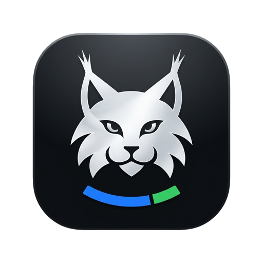
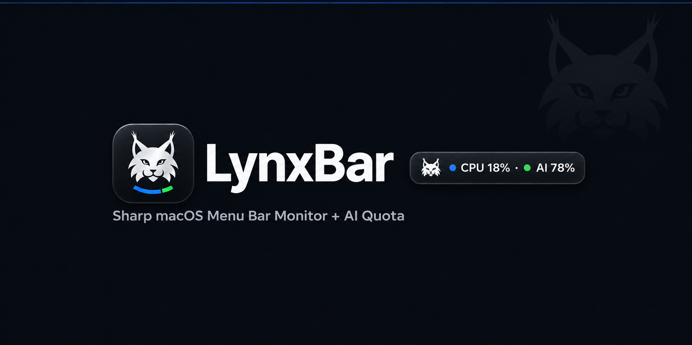

<p align="center">
  
</p>

<h1 align="center">LynxBar</h1>

<p align="center">
  <strong>原生、隐私优先的 macOS 菜单栏系统监控工具，内置安全磁盘清理与可选开启的 AI 订阅额度监控。</strong>
</p>

<p align="center">
  基于 Swift 6（<code>complete</code> 严格并发）、AppKit 与 SwiftUI 构建，AI 额度引擎接入 <code>CodexBarCore</code>（MIT）。
</p>

<p align="center">
  <a href="https://github.com/swnb/lynxbar/actions/workflows/ci.yml"></a>
  
  
  
  <a href="https://github.com/swnb/lynxbar/releases"></a>
  <a href="./LICENSE"></a>
</p>

<p align="center">
  <a href="./README.md">English</a> · <strong>简体中文</strong>
</p>

<p align="center">
  <a href="#核心特性">核心特性</a> •
  <a href="#隐私承诺">隐私承诺</a> •
  <a href="#安装指南">安装指南</a> •
  <a href="#架构亮点">架构亮点</a> •
  <a href="#文档与社区">文档与社区</a>
</p>

<p align="center">
  
</p>

---

## 核心特性

### 菜单栏与 `420×600` 控制面板
- **单一状态栏图标（`LSUIElement`）**：无 Dock 图标静默驻留菜单栏，提供三种显示模式：
  - **精简（Minimal）**：仅显示系统健康状态图标
  - **单项（Focus）**：显示 1 个指标槽位
  - **紧凑（Compact）**：最多显示 3 个槽位（默认：`CPU`、`DSK`、`NET`）
- **9 个菜单栏指标槽位**：`CPU`、`MEM`（内存）、`DSK`（磁盘占用）、`NET`（网络 ↓/↑）、`GPU`、`TMP`（系统热状态）、`BAT`（内置电池）、`ACC`（外设电量）与 `AI`（AI 额度）。
- **固定 `420×600` 面板**：顶部栏提供快捷设置齿轮按钮（`⚙`），支持概览与各资源详情页及可自定义的底部导航栏。
- **外观模式**：可在设置中切换 **跟随系统（System）**（默认）、**深色（Dark）** 或 **浅色（Light）**。

### 系统监控
- **概览（Overview）**：诚实健康评估（`Healthy` / `Attention` / `Critical` / `Collecting`）、最近 60 秒主趋势（`CPU` / `Memory` / `Network`）、高优先级可解释 `Attention`、Top 3 进程，以及开启后自适应嵌入的紧凑 `AI 额度` 行。
- **CPU**：总占用、分核负载柱状图、Load Average（`1 / 5 / 15m`）、运行时长、热状态上下文与高 CPU 进程排行。
- **内存（Memory）**：基于事件源的 macOS Memory Pressure（`DispatchSource.makeMemoryPressureSource`）、Active / Wired / Compressed 构成、Swap 与高内存进程。
- **磁盘（Disk）**：根卷 `/` 容量与低频趋势（`10 分钟` / `1 小时` / `1 天`采样周期；`1h` / `1d` / `1w` 视图范围）、挂载卷列表，以及安全磁盘清理入口。
- **网络（Network）**：基于默认路由的主物理接口（`SystemConfiguration` + `sysctl` 64 位计数器）、上传/下载速率、按需进程流量归因（`nettop`）、主内网 IP 与 MAC 地址，以及默认关闭的公网 IP 查询。
- **GPU**：Metal 设备信息、兼容硬件实时利用率与热状态上下文。
- **电池与外设（Battery）**：内置电池电量/健康度/充放电功耗，以及 `GameController` 手柄电量和可选开启的标准蓝牙电量服务（`180F` / `2A19`）。
- **热状态与进程（Thermal & Processes）**：公开 `ProcessInfo.thermalState` 订阅状态，以及 Top `5–20` 进程列表和引导式 `退出` / `强制退出` 处置流程。

### 安全移至废纸篓的磁盘清理（Disk Cleanup）
在 **磁盘（Disk）** 面板点击 **检查文件…（Review Files…）** 打开 **LynxBar — 安全释放空间** 独立窗口：
- **严格目录范围**：仅允许扫描 `下载` 文件夹或用户手动选择的目录；明确拒绝卷根目录、用户主目录（`~`）、`~/Library` 及其子目录、符号链接、`.app` 应用包及非本地卷。
- **保守筛选规则**：仅列出已下载至本地、非隐藏、硬链接数为 `1` 的常规文件，且满足 **大文件**（`≥ 1 GiB`）或 **陈旧大文件**（`≥ 100 MiB` 且 `≥ 90` 天未修改）。
- **安全执行保障**：默认零预选，支持 **全部 / 大文件 / 陈旧** 筛选、**在访达中显示**、二次确认弹窗，并在移入 macOS **废纸篓** 前逐项重新校验文件身份与路径边界（绝不永久删除）。

### 可选开启的多服务商 AI 订阅额度监控（AI 额度）
- **默认完全关闭且独立开关**：**Claude**、**OpenAI Codex** 与 **Antigravity** 均在 **AI** 标签页及 **设置 → 隐私** 提供独立开关且默认 `false`，未开启的服务商零凭据读取、零网络请求。
- **基于 `CodexBarCore`（MIT）与严格隐私边界**：通过薄适配层复用上游最新 Provider 协议，并显式禁用所有浏览器 Cookie 抓取策略（`cookieSource = .off`）：
  - **Claude**：仅 OAuth 模式（读取 macOS 钥匙串 `"Claude Code-credentials"` 或 `~/.claude/.credentials.json`）。
  - **OpenAI Codex**：本机 CLI / OAuth 凭据（`$CODEX_HOME/auth.json` 或 `~/.codex/auth.json`）。
  - **Antigravity**：本机 Antigravity 桌面应用、IDE 或 `agy` CLI 会话（替代已下线消费端的旧 Gemini CLI）。
- **多卡片同屏与明细视图**：每个已启用服务商独立渲染一张 `V2Card`，展示套餐/账号标签、单卡刷新、滚动或分模型配额窗口（`5 小时会话`、`7 天每周`、`代码审查`、`Gemini 模型`、`Claude 与 GPT` 与分模型配额）、**超额花费（Extra usage）**、**积分余额（Credits）**、重置倒计时及 **剩余 / 已用** 显示口径切换。
- **菜单栏与概览集成**：支持 `AI` 菜单栏槽位（展示最受限且未过期服务商的百分比，如 `AI 78%`；VoiceOver/Tooltip 完整播报所有活跃服务商；关闭/不可用/超过 15 分钟 TTL 时显示 `AI —`）以及严格保留 `420×600` 零溢出预算的 `36pt` `概览` 紧凑行（支持 1–3 个服务商）。
- **健壮的按需调度**：仅在面板可见或菜单栏配置了 `AI` 槽位时按服务商每 5 分钟独立轮询一次，内置隔离的 60 秒冷却窗口、单飞请求去重、5 秒手动刷新节流、`429` 指数退避（尊重 `Retry-After`）、失败时保留旧快照（Stale-while-error）以及缺失/过期时的 CLI 登录引导（`claude /login`、`codex login`、`agy login`）。

---

## 隐私承诺

- **零遥测与零云同步**：无统计埋点、无崩溃上报、无远端存储、无常驻后台守护进程。
- **默认零外网请求**：**显示公网 IP**（`showPublicIP`）与各 AI 服务商独立开关（`claudeUsageEnabled`、`codexUsageEnabled`、`antigravityUsageEnabled`）默认均为 `false`。
- **严格凭据边界**：显式禁用浏览器 Cookie 抓取（`cookieSource = .off`）、绝不保存明文密码、绝不写入钥匙串或本机 CLI 凭据文件。
- **敏感信息脱敏日志**：结构化 `os.Logger`（`com.swnb.LynxBar`）严禁在任何日志级别输出 OAuth Token、认证头、原始钥匙串 JSON 或响应正文；路径、IP 与用户名统一标记 `.private`。
- **透明权限说明**：采用非沙盒 Developer ID 分发配置（`com.apple.security.app-sandbox = false` 配合 Hardened Runtime 与 `com.apple.security.network.client = true`），仅用于支持 `nettop` 进程网络归因与本机 AI CLI / 应用配额检测。

---

## 安装指南

### 系统要求
- **macOS 14.0 (Sonoma)** 及以上版本（**Universal 通用二进制**：同时支持 Apple Silicon 与 Intel）

### Homebrew 一键安装（推荐）
通过官方独立 Tap 一行命令安装（自动校验 `SHA-256` 并清除 macOS 隔离属性，装完直接打开、零弹窗）：

```sh
brew install --cask swnb/tap/lynxbar
```

后续升级：

```sh
brew upgrade --cask swnb/tap/lynxbar
```

### GitHub Releases（手动下载）
直接前往 **[GitHub Releases（最新版）](https://github.com/swnb/lynxbar/releases/latest)** 下载通用安装包：
- **`LynxBar-<version>-universal.dmg`** / **`.zip`** — 已签名公证的 Developer ID 通用安装包（配置 Apple 签名密钥时产出）
- **`LynxBar-<version>-universal-unsigned.dmg`** / **`.zip`** — 社区免费 ad-hoc 通用安装包（附带 `SHA256SUMS.txt` 校验和）

将 `LynxBar.app` 拖入 `/Applications` 后，可用 `shasum -a 256 -c SHA256SUMS.txt` 校验完整性。如果通过浏览器下载了**未签名（unsigned）**版本，首次启动前执行一次以下命令解除 macOS Gatekeeper 隔离属性即可：

```sh
xattr -cr /Applications/LynxBar.app
```

### 从源码编译
需要安装包含 **Swift 6** 的 Xcode 与 [XcodeGen](https://github.com/yonaskolb/XcodeGen)（`2.46.0` 或更高版本）：

```sh
brew install xcodegen
git clone https://github.com/swnb/lynxbar.git
cd lynxbar
make build
make run
```

也可直接生成并打开 Xcode 工程：

```sh
xcodegen generate && open LynxBar.xcodeproj
```

---

## 架构亮点

- **按需驱动采样（`MonitoringDemandCoordinator`）**：通过 `.panel`、`.overviewHealth`、`.menuBar` 与 `.remediation` 四类引用计数租约触发 `0 ↔ 1` 采样边沿，确保 `nettop` 进程归因或 AI 额度请求仅在真正需要时运行；`.aiUsage` 不包含在 `overviewHealthModules` 中。
- **四层有界本地历史**：内存保留 5 分钟实时原始样本，持久化四层平均聚合桶（`15s` / `1m` / `5m` / `30m`，最长 1 周，每序列约 1,164 个桶），原子写入 `~/Library/Application Support/LynxBar/history-v3.plist`。
- **诚实数值语义（「未知绝不显示为 0」）**：凭据缺失、Token 过期、网络断连、历史预热或功能未开启均展示明确状态，绝不伪造 `0%` 或 `100%`。
- **极简依赖架构**：所有系统硬件监控模块纯基于 Apple 系统框架（`AppKit`、`SwiftUI`、`Combine`、`IOKit`、`Metal`、`GameController`、`CoreBluetooth`、`Security`、`SystemConfiguration`、`ServiceManagement`、`os`）；可选开启的 AI 额度模块通过 SwiftPM 引入开源的 [`CodexBarCore`](https://github.com/steipete/CodexBar)（MIT），并显式关闭浏览器 Cookie 抓取（`cookieSource = .off`）。

---

## 非官方 AI 额度接口声明

AI 额度监控功能由开源的 [`CodexBarCore`](https://github.com/steipete/CodexBar)（MIT）驱动，通过本机 CLI / 应用凭据与本地探针获取 Claude、OpenAI Codex 与 Antigravity 额度（显式禁用浏览器 Cookie 抓取）。这些接口或本地探针均属于**非官方、未公开文档的实现**，其返回结构、请求头或可用性可能随时变更，且使用受对应服务商服务条款约束。

- 各服务商均**默认关闭**，需用户明确了解后逐个主动启用。
- 每个服务商轮询频率限制为 5 分钟一次，并内置冷却期与 `429` 指数退避，避免对上游造成压力。
- **LynxBar 为独立开源项目，与 Anthropic、OpenAI 或 Google 没有任何官方隶属、背书或赞助关系。**

---

## 文档与社区

- [用户指南](./docs/guides/user-guide.md) — 菜单栏模式、磁盘安全清理、Claude/Codex/Antigravity 配置及外观/隐私设置说明
- [开发者入门](./docs/development/getting-started.md) — 本地编译、0 警告冷构建门禁、单元测试、本地化校验与 QA 调试参数
- [核心架构规范](./docs/architecture/v2-architecture-design.md) — 信息架构、按需采样、指标口径与有界历史设计
- [贡献指南](./CONTRIBUTING.md) — Swift 6 并发规范、CI 检查与新增 `AIUsageProvider` 步骤
- [安全策略](./SECURITY.md) — 漏洞披露渠道、钥匙串只读边界与日志脱敏规则
- [更新日志](./CHANGELOG.md) — 版本发布记录

## 开源许可

本项目基于 [MIT License](./LICENSE) 开源。
