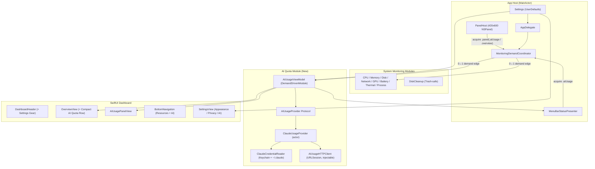
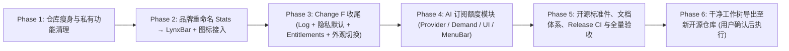

# LynxBar：AI 订阅额度监控与开源标准化技术方案

> **文档状态**：已实施（Phases 1–5 架构设计基线）  
> **目标品牌**：`LynxBar`（原 `Stats`） · 仓库 `github.com/swnb/lynxbar` · Bundle ID `com.swnb.LynxBar`  
> **适用基线**：Swift 6（`SWIFT_STRICT_CONCURRENCY: complete`）· macOS 13.0+ · XcodeGen · 零第三方依赖 · 0-warning CI 门禁

---

## 目录与快速导航

1. [背景与目标](#1-背景与目标)
2. [总体架构与模块边界](#2-总体架构与模块边界)
3. [核心功能设计：AI 订阅额度模块（简化版 CodexBar）](#3-核心功能设计ai-订阅额度模块简化版-codexbar)
   - [3.1 可扩展 Provider 抽象与数据模型](#31-可扩展-provider-抽象与数据模型)
   - [3.2 Claude OAuth 凭据读取与 Usage API 协议](#32-claude-oauth-凭据读取与-usage-api-协议)
   - [3.3 隐私门控、按需采样与刷新/退避状态机](#33-隐私门控按需采样与刷新退避状态机)
   - [3.4 菜单栏槽位、Overview 摘要与 420×600 面板布局](#34-菜单栏槽位overview-摘要与-420600-面板布局)
4. [技术债收尾（Change F + 亮/暗外观设置）](#4-技术债收尾change-f--亮暗外观设置)
5. [开源标准化改造与仓库清理清单](#5-开源标准化改造与仓库清理清单)
   - [5.1 移除私有耦合（CargoCacheCleanup）](#51-移除私有耦合cargocachecleanup)
   - [5.2 全局品牌重命名（Stats → LynxBar）与数据迁移边界](#52-全局品牌重命名stats--lynxbar与数据迁移边界)
   - [5.3 仓库瘦身与文档体系重组](#53-仓库瘦身与文档体系重组)
   - [5.4 开源社区标准件、CI 与自动化 Release 分发](#54-开源社区标准件ci-与自动化-release-分发)
6. [分阶段实施路线与依赖关系](#6-分阶段实施路线与依赖关系)
7. [测试策略与开源验收门禁](#7-测试策略与开源验收门禁)
8. [风险与合规说明](#8-风险与合规说明)

---

## 1. 背景与目标

本项目当前处于 `chore/debt-remediation` 分支，已完成采样门控（Change A）、数值精度（Change B）、有界历史存储（Change C）、渲染性能（Change D）与双外观/Dynamic Type（Change E）。为将项目正式打磨为高质量的国际开源 macOS 工具，本方案统一规划两条主线：

1. **新增 AI 订阅额度监控模块（简化版 CodexBar）**：
   - v1 聚焦 **Claude（Pro / Max / Claude Code）**，底层抽象可扩展 `AIUsageProvider` 协议，便于后续接入 OpenAI Codex、Gemini 等。
   - **隐私与信任底线**：默认关闭（显式 Opt-in），仅只读复用本机 Claude Code OAuth 凭据，绝不触碰浏览器 Cookie、不保存明文密码、不静默拉起浏览器、不记录任何敏感日志。
   - 深度融入既有按需采样框架（`MonitoringDemandCoordinator`）、单一菜单栏状态槽（`MenuBarStatusSlot`）与 `420 × 600` 固定面板。
2. **达到国际开源发布标准并完成独立品牌化（LynxBar）**：
   - 更名为 **LynxBar**（`com.swnb.LynxBar`），彻底规避与 `exelban/stats` 的命名及 Homebrew Cask 冲突。
   - 移除强依赖本机私有脚本的 `CargoCacheCleanup`，清理个人遗留文件、54MB 历史 QA 截图、`website/` 与 `openspec/`。
   - 补齐技术债 **Change F**（`os.Logger` 诊断日志、公网 IP 默认关闭、Entitlements）及系统外观切换（`System / Dark / Light`）。
   - 补齐 MIT 开源标准件（英文主 `README.md` + `README.zh-CN.md`、`LICENSE`、`CONTRIBUTING.md`、`SECURITY.md`、`CHANGELOG.md`、Issue/PR 模板）与 Tag 自动 Release Workflow。
   - 最终以干净工作树推送至全新公开仓库 `github.com/swnb/lynxbar`（单次 clean initial commit，本地旧仓保留作归档备份）。

---

## 2. 总体架构与模块边界



### 设计约束（与现有工程基线完全一致）
- **零第三方依赖**：仅使用 `Foundation`、`Security`（Keychain 读取）、`os`、`AppKit`、`SwiftUI`、`Combine` 及既有系统框架。
- **Swift 6 严格并发**：所有跨 actor 模型均显式遵守 `Sendable`，禁止使用 `@unchecked Sendable` 绕过检查。
- **诚实数值语义**：「不知道不得显示为 0」。未启用、凭据缺失、Token 过期、网络离线或接口错误均通过显式状态枚举表达，绝不回退成 `0%` 或 `100%`。
- **可测试性**：凭据读取（`ClaudeCredentialReading`）、HTTP 传输（`AIUsageHTTPTransport`）、时钟（`() -> Date`）全部面向协议注入，单元测试完全离线运行、不触发真实 Keychain 弹窗、不发起真实网络请求。

---

## 3. 核心功能设计：AI 订阅额度模块（简化版 CodexBar）

### 3.1 可扩展 Provider 抽象与数据模型

新建目录：
- `Sources/LynxBar/Providers/AIUsage/`（数据模型、Provider 协议、Claude 实现、Keychain/文件凭据读取）
- `Sources/LynxBar/Modules/AIUsage/`（`AIUsageViewModel`、`AIUsagePanelView`、进度条与倒计时子视图）

#### 核心类型定义

```swift
/// Supported AI subscription providers. Raw values are persisted in Settings.
enum AIUsageProviderID: String, CaseIterable, Codable, Identifiable, Sendable {
    case claude
    // Future: case codex, gemini, cursor, copilot

    var id: Self { self }
}

/// User-selectable percentage display convention for quota bars & menu bar.
enum AIQuotaDisplayStyle: String, CaseIterable, Codable, Identifiable, Sendable {
    /// CodexBar style: "78% left" (remaining capacity before reset).
    case remaining
    /// Hardware-consistent style: "22% used".
    case used

    var id: Self { self }
}

/// A single rate-limit rolling window (e.g., 5-hour session or 7-day weekly).
struct AIQuotaWindow: Equatable, Sendable {
    enum Kind: String, Equatable, Sendable {
        case session5h
        case weekly7d
        case weeklyModelSpecific
    }

    let id: String
    let kind: Kind
    /// Localized or provider-supplied label (e.g., "5-hour session", "7-day weekly", "Sonnet 7-day").
    let title: String
    /// Raw server utilization ratio clamped to 0...1 (e.g., 0.22 means 22% used, 78% remaining).
    let usedRatio: Double
    /// Exact reset timestamp if reported by the provider.
    let resetsAt: Date?

    var remainingRatio: Double {
        max(0, min(1, 1.0 - usedRatio))
    }

    func displayedRatio(style: AIQuotaDisplayStyle) -> Double {
        switch style {
        case .remaining: return remainingRatio
        case .used: return usedRatio
        }
    }
}

/// Optional pay-as-you-go / overage spend summary reported alongside subscription windows.
struct AIExtraUsageSummary: Equatable, Sendable {
    let isEnabled: Bool
    let usedAmount: Double?
    let monthlyLimit: Double?
    let currencyCode: String
}

/// Immutable snapshot for one AI provider.
struct AIProviderQuotaSnapshot: Equatable, Sendable {
    let providerID: AIUsageProviderID
    /// Primary rolling window (Claude: 5-hour session) — drives menu bar & Overview summary.
    let primaryWindow: AIQuotaWindow?
    /// Secondary rolling window (Claude: 7-day weekly).
    let secondaryWindow: AIQuotaWindow?
    /// Additional breakdown windows (e.g., model-specific 7-day quotas) when returned.
    let additionalWindows: [AIQuotaWindow]
    let extraUsage: AIExtraUsageSummary?
    /// Optional subscription tier metadata if available from credentials/API (e.g., "Pro", "Max").
    let planLabel: String?
    /// Timestamp of this successful upstream fetch.
    let fetchedAt: Date
}

/// Explicit failure taxonomy so UI can render actionable remediation instead of opaque errors.
enum AIUsageFetchError: Error, Equatable, Sendable {
    case disabled
    case credentialsMissing
    case credentialsMalformed
    case tokenExpired
    case unauthorized
    case rateLimited(retryAfter: TimeInterval?)
    case endpointUnavailable(statusCode: Int)
    case networkFailure(String)
    case decodingFailure(String)
}

/// Protocol implemented by each AI subscription provider.
protocol AIUsageProvider: Sendable {
    var id: AIUsageProviderID { get }
    func fetchQuota(now: Date) async -> Result<AIProviderQuotaSnapshot, AIUsageFetchError>
}
```

### 3.2 Claude OAuth 凭据读取与 Usage API 协议

#### 1) 凭据读取链路（严格只读、零写入）

`ClaudeCredentialReader` 按确定性顺序尝试获取有效 `accessToken`（仅在用户开启 AI 额度后才会调用）：

1. **优先读取 macOS Keychain**：
   - 使用 `Security.framework` 的 `SecItemCopyMatching` 查询 `kSecClassGenericPassword`，`kSecAttrService = "Claude Code-credentials"`（仅读 `kSecReturnData: true`）。
   - 解析 JSON 中的 `claudeAiOauth.accessToken` 与 `claudeAiOauth.expiresAt`（毫秒或秒时间戳统一兼容）以及可选 `subscriptionType` / `rateLimitTier`。
   - **兼容已知陷阱**：若 Keychain 项存在但只包含 MCP OAuth 字段而无 `claudeAiOauth.accessToken`，视为未命中主凭据并继续检查回退路径（避免误报或死循环）。
2. **回退读取本机凭据文件**：
   - `~/.claude/.credentials.json`（只读文件权限，同样解析 `claudeAiOauth` 结构）。
3. **过期预检**：
   - 若 `expiresAt` 已早于当前时间（留 30 秒安全余量），直接返回 `.failure(.tokenExpired)`，**不发起必然 401 的无效网络请求**，也**绝不自动执行 CLI 或拉起浏览器**。
   - UI 给出清晰引导：「请在终端运行 `claude /login` 刷新登录态，然后点击刷新」。

#### 2) 上游 Usage API 请求与解码

- **Endpoint**：`GET https://api.anthropic.com/api/oauth/usage`
- **Headers**：
  - `Authorization: Bearer <accessToken>`
  - `Accept: application/json`
  - `anthropic-beta: oauth-2025-04-20`
  - `User-Agent: LynxBar/<CFBundleShortVersionString>`
- **Timeout**：`15s`（使用独立 ephemeral `URLSessionConfiguration`，不落盘 Cookie 与 HTTP Cache）。
- **响应 JSON 宽容解码**（所有字段均设为可选，防上游 schema 微调导致整页崩溃）：
  - `five_hour`: `{ utilization: Double?, resets_at: String? }` → 映射到 `primaryWindow`（注意：Anthropic 返回的 `utilization` 为 `0...100` 百分数，归一化到 `0...1` 并 clamp；同时做防御检测避免负值或 NaN）。
  - `seven_day`: `{ utilization: Double?, resets_at: String? }` → 映射到 `secondaryWindow`。
  - `seven_day_sonnet` / `seven_day_opus` / `seven_day_oauth_apps` 等可选分模型窗口 → 非空时按序放入 `additionalWindows`。
  - `extra_usage`: `{ is_enabled: Bool?, used_credits: Double?, monthly_limit: Double?, currency: String? }` → 映射到 `extraUsage`（仅当 `is_enabled == true` 且字段有效时展示）。
  - ISO-8601 时间解析兼容带小数秒与不带小数秒两种格式。
- **HTTP 状态码映射**：
  - `200`: 解码并返回 `.success`（若 `five_hour` 与 `seven_day` 同时缺失则判定 `.decodingFailure`，不伪造 0%）。
  - `401 / 403`: `.unauthorized`（提示重新运行 `claude /login`）。
  - `429`: 解析 `Retry-After` 响应头，返回 `.rateLimited(retryAfter:)`。
  - `404 / 410 / 5xx`: `.endpointUnavailable(statusCode:)`。

### 3.3 隐私门控、按需采样与刷新/退避状态机

严格对齐 `MonitoringDemandCoordinator` 与 `DemandDrivenModule`：

1. **新增 `MonitoringModule.aiUsage`**：
   - `MonitoringDemandBinding.modules(for: .aiUsage)` → `[.aiUsage]`。
   - `MonitoringDemandBinding.modules(for: .overview)` → 当且仅当后续由 `AIUsageViewModel` 内部守卫 `settings.aiUsageEnabled` 时才实际发起采样；或直接把 `.aiUsage` 加入 `.overview` 的 demand 列表，同时在 `AIUsageViewModel.startSampling()` 中以 `settings.aiUsageEnabled` 作为硬门槛（与 `AccessoryPowerViewModel` 处理 `standardBLEBatteryEnabled` 的模式**完全同构**！）。
   - `overviewHealthModules` **不包含** `.aiUsage` —— 面板关闭且菜单栏未配置 `.aiUsage` 槽位时，**零后台定时轮询、零网络请求**。
   - 菜单栏配置了 `MenuBarStatusSlot.aiUsage` 时，由 `MenuBarDemandLeaseStore` 持有 `.menuBar` demand token，按低频周期刷新。
2. **刷新频率与节流防抖**：
   - **默认正常轮询间隔**：`300s`（5 分钟），不受系统监控 `updateInterval`（1/2/5/10 秒）影响。
   - **最小拉取保护（Cooldown）**：`startSampling()` 立即触发一次检查时，若距离上次成功拉取不足 `60s`，复用内存快照而不重复请求（防止用户频繁开关面板触发 429）。
   - **手动刷新按钮**：允许突破 60s 缓存，但内置 `5s` 防连点节流与单飞（in-flight deduplication）保证同时最多 1 个在途请求。
   - **429 / 失败指数退避**：
     - 遇到 `429` 时优先尊重 `Retry-After`；否则按 `5m → 10m → 20m → 30m` 上限退避。
     - 遇到 `tokenExpired / unauthorized / credentialsMissing` 时**停止自动重试**，等待用户修复后点「手动刷新」或重新打开面板再试一次（避免无效重试刷屏或反复触发 Keychain 弹窗）。
3. **陈旧快照策略（Stale-while-error）**：
   - 若已有上一次成功快照 `lastSnapshot`，后续刷新失败（如断网或 429）时**保留 `lastSnapshot`**，并在 UI 顶部展示非阻塞状态条（如「更新失败：触发限流 · 显示 12 分钟前数据」）。
   - 菜单栏槽位 TTL 设为 `15 分钟`（3× 轮询周期）：超过 15 分钟未成功更新自动进入 `.stale` 并显示 `AI —`，不误导用户。

### 3.4 菜单栏槽位、Overview 摘要与 420×600 面板布局

#### 1) 顶部导航改造（释放底部栏空间）
- `DashboardHeader`（高度 `42pt`）右侧结构调整为：`[● Live]` + `[⚙ Settings 图标按钮]`（点击切换 `selection = .settings`，选中态用 `Theme.selection` + `Theme.selectionSoft` 高亮，保留键盘 Focus Ring 和 VoiceOver 标签）。
- `BottomNavigation`（高度 `62pt`）仅放核心视图目的地：`Overview` + 已启用的资源模块（`CPU` / `Memory` / `Disk` / `Network` / `GPU` / `Battery`）+ `AI`（最多 8 格，与现有宽度密度持平，英文/中文标签均不截断）。
- `Settings` 中的「可见目的地」新增 `AI Quota` 开关（控制底部 `AI` Tab 显隐；开启 Tab 不等于开启外网拉取，外网读取仍由独立隐私开关 `aiUsageEnabled` 控制，避免误触）。

#### 2) 菜单栏槽位（`MenuBarStatusSlot.aiUsage`）
- 新增 `case aiUsage` 映射到 `MonitoringModule.aiUsage`。
- `MenuBarStatusFormatter`：
  - 短标签：`AI`
  - 数值：读取 `primaryWindow`（5h 会话）按用户口径（`remaining` 或 `used`）格式化为 `AI 78%`；未启用/无凭据/超 TTL 显示 `AI —`。
  - 无障碍/Tooltip 完整文案：如 `Claude quota 78% remaining, resets in 2h 14m` / `Claude 额度剩余 78%，2 小时 14 分后重置`。
- 当菜单栏槽位包含 `.aiUsage` 但 `settings.aiUsageEnabled == false` 时，槽位显示 `AI —`（不静默发请求），并在 Settings 槽位选择区给出一行提示。

#### 3) Overview 紧凑摘要与 420×600 垂直高度预算
现有 `OverviewView` 可用高度为 `600 - 42 (Header) - 62 (BottomNav) = 496pt`。当前四张卡片总高为 `126 + 141 + 61 + 136 + 3×6 + 12 = 494pt`（已贴近极限）。

因此采用**自适应零滚动布局**：
- 当 `settings.aiUsageEnabled == false`：保持现有 4 卡片精确高度（零视觉回归）。
- 当 `settings.aiUsageEnabled == true`：在 `healthCard` 与 `trendCard` 之间插入一张 `36pt` 高度的紧凑 `OverviewAIQuotaRow`（显示图标 + `Claude` + 5h/7d 迷你进度条或主百分比 + 重置倒计时 + 右箭头点击跳转 `.aiUsage`），同时微调高度保持总高严格 ≤ `494pt`：
  - `healthCard`: `120pt`（-6pt）
  - `aiQuotaRow`: `36pt`（新增）
  - `trendCard`: `121pt`（-20pt）
  - `attentionCard`: `56pt`（-5pt）
  - `processCard`: `125pt`（-11pt）
  - 间距与内边距：`4×6 + 12 = 36pt` → 总高 `494pt ≤ 496pt`，无溢出、无需滚动。

#### 4) AI 详情页（`AIUsagePanelView`）状态矩阵
- **未启用态（默认首屏）**：清晰说明卡片——展示「只读本机 Claude Code OAuth 凭据，直接连接 Anthropic 查询 5h / 7d 额度，不读取浏览器 Cookie、不保存密码、不上传任何数据」，提供主按钮「启用 Claude 额度监控」。
- **已启用·正常态**：
  - 顶部标题行：Provider 标题（`Claude` + Plan Badge 若有）+ 上次更新时间 + 手动刷新按钮（加载中显示小号 ProgressView）。
  - **5-Hour Session 主卡片**：大号数字（如 `78% left` 或 `22% used`）、语义色进度条（剩余 > 30% 绿色 `Theme.health`，10%–30% 琥珀 `Theme.warning`，≤ 10% 红色 `Theme.critical`）、精准重置倒计时（如 `Resets in 2h 14m · 18:30`）。
  - **7-Day Weekly 卡片**：同等规格进度条与重置倒计时（如 `Resets Thu 08:00`）。
  - **扩展明细区（条件显示）**：若接口返回分模型 7d 配额或 `extra_usage` 超额花费，以紧凑列表卡片展示；否则不占位。
  - **底部信息条**：当前口径切换快捷提示或「在 Settings 中切换 剩余/已用」+ 隐私说明。
- **错误 / 引导态**：
  - `credentialsMissing`：提示未检测到 Claude Code 登录凭据，给出命令 `claude /login`（带一键复制按钮）+「重试」按钮。
  - `tokenExpired / unauthorized`：提示登录态已过期，同样给出 `claude /login` 复制按钮 +「重试」按钮。
  - `rateLimited / networkFailure / endpointUnavailable`：若有旧快照则顶部黄色条提示原因并保留旧数据；若无旧快照则展示诊断说明与「重试」按钮。

---

## 4. 技术债收尾（Change F + 亮/暗外观设置）

按既有技术债计划并结合新品牌 `LynxBar` 一次性收口：

### 4.1 结构化诊断日志（`os.Logger`）
- 新增 `Sources/LynxBar/Kit/Log.swift`，subsystem 统一为 `com.swnb.LynxBar`：
  - `Log.app` / `Log.sampling` / `Log.history` / `Log.network` / `Log.aiUsage`
- 审计全仓 `try?` 与 `catch` 块（排除 `Task.sleep` 取消路径），补充结构化错误日志。
- **隐私硬规则**：
  - 公网 IP、进程路径、用户名等一律 `.private`。
  - OAuth Token、Authorization Header、原始 Keychain JSON **禁止进入任何级别日志**（连 `.debug` / `.private` 也不输出）。

### 4.2 隐私默认值与说明
- `Settings.showPublicIP` 默认值从 `true` 改为 `false`（保留老用户已写入 UserDefaults 的显式偏好）。
- `SettingsView` 的 Privacy 分组清晰说明两项**唯二**可能触发外网请求的可选功能：
  1. **Show public IP**（默认关，每 10 分钟请求 `ipify / ifconfig.me / icanhazip`）
  2. **Claude subscription quota**（默认关，只读本机 Claude Code OAuth，每 5 分钟按需请求 `api.anthropic.com`）

### 4.3 规范 Entitlements（非沙盒 Developer ID 分发路径）
- 新增 `Sources/LynxBar/Resources/LynxBar.entitlements`：
  - `com.apple.security.app-sandbox`: `false`（保留 `nettop` 进程网络归因与只读本机 `~/.claude/.credentials.json` 能力）
  - `com.apple.security.network.client`: `true`
- 在 `project.yml` 中为 `LynxBar` target 绑定 `CODE_SIGN_ENTITLEMENTS: Sources/LynxBar/Resources/LynxBar.entitlements`，维持 `ENABLE_HARDENED_RUNTIME: YES`。

### 4.4 外观模式设置（`AppAppearanceMode`）
- 新增 `enum AppAppearanceMode: String, CaseIterable, Identifiable, Sendable { case system, dark, light }`，持久化在 `Settings.appearanceMode`（默认 `.system`）。
- 移除 `AppDelegate.applicationDidFinishLaunching` 中硬编码的 `NSApp.appearance = NSAppearance(named: .darkAqua)`；改为根据 `settings.appearanceMode` 动态应用：
  - `.system` → `NSApp.appearance = nil`
  - `.dark` → `NSApp.appearance = NSAppearance(named: .darkAqua)`
  - `.light` → `NSApp.appearance = NSAppearance(named: .aqua)`
- `PanelHost` 已有 `effectiveAppearance` KVO 监听会自动刷新圆角背景色，`DiskCleanup` 独立窗口与 `About` 窗口同步跟随 `NSApp.appearance`。
- 在 `SettingsView` 的 General 分组添加 Appearance 选择器（System / Dark / Light）。

---

## 5. 开源标准化改造与仓库清理清单

### 5.1 移除私有耦合（`CargoCacheCleanup`）
彻底删除以下文件及全部引用，保证所有 UI 入口对任意外部开源用户开箱即用：
- `Sources/Stats/Providers/CargoCacheCleanup/`
- `Sources/Stats/Modules/CargoCacheCleanup/`
- `Sources/Stats/Resources/cargo_cache_cleanup.py`
- `Tests/StatsTests/CargoCacheCleanupTests.swift`
- `scripts/test_cargo_cache_cleanup.py`
- `docs/cargo-cache-cleanup.md`
- 清理 `DiskPanelView.swift`、`Localizable.strings`（`en` / `zh-Hans`）中对应按钮与文案。

> 保留并继续维护通用、安全、移至废纸篓的 `DiskCleanup` 模块。

### 5.2 全局品牌重命名（`Stats` → `LynxBar`）与数据迁移边界
- **工程与标识**：
  - `project.yml`：name `LynxBar`，`bundleIdPrefix: com.swnb`，target 改为 `LynxBar` / `LynxBarTests` / `LynxBarProcessQAHelper`，Bundle ID 改为 `com.swnb.LynxBar`。
  - 目录重命名：`Sources/Stats` → `Sources/LynxBar`，`Sources/StatsProcessQAHelper` → `Sources/LynxBarProcessQAHelper`，`Tests/StatsTests` → `Tests/LynxBarTests`。
  - 代码中所有 `@testable import Stats` → `@testable import LynxBar`，`Eligibility.swift` 默认 Bundle ID fallback 改为 `com.swnb.LynxBar`，`MetricHistoryStore` 存储目录更新为 `~/Library/Application Support/LynxBar/`。
  - `DashboardHeader`、`AboutView`、右键菜单（About LynxBar / Quit LynxBar）、中英文 `Localizable.strings`、`Makefile`、`scripts/release.sh`、`Casks/lynxbar.rb` 全部同步更新。
- **App 图标与菜单栏图标接入**：
  - 新增 `Sources/LynxBar/Resources/Assets.xcassets`（包含由 ChatGPT 套图切出的 `AppIcon.appiconset` 全尺寸 PNG 及菜单栏黑白 `MenuBarIcon.imageset` Template Image），在 `project.yml` 中启用 `ASSETCATALOG_COMPILER_APPICON_NAME: AppIcon`。

### 5.3 仓库瘦身与文档体系重组
- **删除无关与体积膨胀资产**：
  - 根目录个人/临时文件：`小型强化学习机器人方案说明_20261022.docx`、`default.profraw`、`.remember/`、`.superpowers/`
  - 内部过程目录：`openspec/`、`docs/superpowers/`、`docs/design/`（54MB 历史 QA 对比截图）、`docs/design-qa.md`
  - 独立站点目录：`website/`（同步清理 `.gitignore` 中针对 `website/` 的规则与 `.gitattributes` 中不再需要的历史 LFS 规则）
- **保留与重组后的精简 `docs/` 结构**：
  - `docs/assets/`：仅存放 README 所需的精选品牌图（Hero Banner、Social Preview、1–2 张精选轻量 WebP 实机截图，总计控制 < 2MB）
  - `docs/architecture/`：架构概览、按需采样与历史存储设计、以及本技术方案文档
  - `docs/development/`：本地开发、构建测试、新增 AI Provider 贡献指南
  - `docs/guides/`：用户使用指南、隐私与权限说明（包含 Claude Code OAuth 配置说明）

### 5.4 开源社区标准件、CI 与自动化 Release 分发
- **社区标准件（英文为主，附中文 README）**：
  - `LICENSE`（MIT，Copyright 2026 swnb）
  - `README.md`（英文主文档：Hero Banner、核心特性、隐私承诺、安装方式、架构亮点、构建方式、致谢与免责声明）
  - `README.zh-CN.md`（完整简体中文镜像）
  - `CONTRIBUTING.md`（开发流程、Swift 6 并发与 0-warning 门禁、新增 AI Provider 规范）
  - `SECURITY.md`（安全披露渠道、Keychain 只读边界、无遥测声明）
  - `CHANGELOG.md`（Keep a Changelog 格式，起草 `v0.1.0` 首个开源版本）
  - `.github/ISSUE_TEMPLATE/bug_report.yml`、`feature_request.yml`、`PULL_REQUEST_TEMPLATE.md`
- **CI/CD 双工作流**：
  - `.github/workflows/ci.yml`：同步更名为 `LynxBar` scheme，保留冷构建测试 + `0 warning` 强门禁。
  - `.github/workflows/release.yml`（新增，监听 `v*` tag）：
    1. XcodeGen 生成工程并跑全量单测与 0-warning 检查。
    2. **分支签名策略**：
       - 若仓库配置了 `APPLE_CERTIFICATE_P12`、`APPLE_CERTIFICATE_PASSWORD`、`APPLE_TEAM_ID`、`APPLE_ID`、`APPLE_APP_PASSWORD` Secrets → 自动导入 Developer ID 证书、Release 归档、签名导出、`notarytool` 公证、`stapler` 装订、生成带背景图的 `LynxBar-<version>.dmg` + `SHA256SUMS.txt`。
       - 若未配置签名 Secrets → 自动降级为 ad-hoc/unsigned 构建并打包 `LynxBar-<version>-unsigned.zip` + `SHA256SUMS.txt`，并在 Release Notes 自动标注「未公证构建，建议自行从源码编译或本地右键打开」。
    3. 自动创建 GitHub Release 并上传产物。
  - 更新 `Casks/lynxbar.rb`（指向 `github.com/swnb/lynxbar/releases/download/v#{version}/LynxBar-#{version}.dmg`，`zap trash` 清理 `com.swnb.LynxBar.plist` 与 `~/Library/Application Support/LynxBar`）。

---

## 6. 分阶段实施路线与依赖关系



| 阶段 | 核心交付 | 独立可验证里程碑 |
|---|---|---|
| **Phase 1** | 移除 `CargoCacheCleanup`；清理 `website/`、`openspec/`、54MB `docs/design/` 与根目录个人杂项 | `xcodebuild test` 全绿 + 0 warning |
| **Phase 2** | 全局重命名为 `LynxBar`（`com.swnb.LynxBar`）；接入 `Assets.xcassets` 图标（若有成品图则切图入库） | `LynxBar` scheme 编译、全量单测全绿 + 0 warning |
| **Phase 3** | 引入 `Log.swift`；`showPublicIP` 默认关；新增 `LynxBar.entitlements`；解除强制深色并在 Settings 增加外观切换 | 新增 `SettingsPrivacyTests`、`AppearanceTests` 全绿 |
| **Phase 4** | 实现 `AIUsageProvider` + `ClaudeUsageProvider` + `ClaudeCredentialReader` + `AIUsageViewModel` + `AIUsagePanelView` + `DashboardHeader` Settings 齿轮 + `Overview` 紧凑行 + `MenuBarStatusSlot.aiUsage` | 新增凭据解析、HTTP 状态码/429 退避、Demand 启停、Formatter、UI 布局等全套单测全绿 |
| **Phase 5** | 补齐 `LICENSE`、中英 `README`、`CONTRIBUTING`、`SECURITY`、`CHANGELOG`、Issue/PR 模板、整理 `docs/`、更新 `ci.yml` + 新增 `release.yml` + `Casks/lynxbar.rb` | 清空 DerivedData 冷构建验证 `0 warning` + 全量单测 + 静态隐私/硬编码路径扫描通过 |
| **Phase 6** | 生成开源发布检查清单，待你确认后协助将干净工作树推送至新公开仓 `github.com/swnb/lynxbar` | 公开仓首提交无 LFS 残留、无私有路径、CI 绿灯 |

---

## 7. 测试策略与开源验收门禁

### 新增单元测试覆盖清单（`Tests/LynxBarTests/`）
1. **`ClaudeCredentialReaderTests`**：Keychain JSON 解析、仅含 MCP 状态时正确回退文件、`~/.claude/.credentials.json` 回退读取、缺失/畸形 JSON、过期时间预检（毫秒/秒时间戳）。
2. **`ClaudeUsageProviderTests`**：注入 mock `AIUsageHTTPTransport`，覆盖 `200` 完整响应（`five_hour` + `seven_day` + 分模型 + `extra_usage`）、缺失可选字段、`0...100` 归一化与异常值截断、`401/403`、`429`（含/不含 `Retry-After`）、`500`、断网超时。
3. **`AIUsageViewModelTests`**：默认关闭时 `startSampling()` 零调用；开启后按需拉取；60s 冷却防重复拉取；手动刷新单飞防重入；429 指数退避；失败时保留上次快照（stale-while-error）；鉴权失败停止自动重试；切换 `remaining` / `used` 口径即时生效。
4. **`MenuBarAIUsageTests`**：`MenuBarStatusSlot.aiUsage` 在未启用、可用、超 15 分钟陈旧态下的文案与 VoiceOver 标签（中英双语），以及宽度预算约束。
5. **`MonitoringDemandBindingTests`（扩展）**：验证 `.aiUsage` 不在 `overviewHealthModules` 中；面板切换和菜单栏槽位增删准确触发 0↔1 边沿。
6. **`SettingsPrivacyAndAppearanceTests`**：`showPublicIP` 与 `aiUsageEnabled` 默认均为 `false`；老用户显式偏好不被覆盖；`appearanceMode` 默认 `.system` 且持久化正确。

### 开源发布前自动化门禁（缺一不可）
- **冷构建零警告**：清空 `DerivedData` 后 `xcodegen generate && xcodebuild ... build-for-testing` 中 `: warning:` 计数为 `0`。
- **全量单测通过**：0 failures（仅保留既有需环境变量开启的 `LocalDiskTrashIntegrationTests` 1 skip）。
- **隐私与洁净度扫描**：`rg` 核验源码、脚本与文档中零个人用户名、旧私有缓存脚本标识（legacy cache policy）或本机绝对 home 路径（`<home-dir>/<user>`）残留，零明文 Token 日志输出。
- **双语完整性核验**：`en.lproj` 与 `zh-Hans.lproj` 所有新增文案键 100% 对齐。

---

## 8. 风险与合规说明

1. **Anthropic OAuth Usage 接口稳定性与条款提示**：
   - `api.anthropic.com/api/oauth/usage` 属于 Claude Code 使用的非公开接口，Anthropic 随时可能调整字段结构、Beta Header 或限流策略，且其服务条款对第三方客户端复用订阅 OAuth Token 存在限制。
   - **缓解措施**：
     - 协议层采用严格宽容解码与 5 分钟低频 + 429 退避，绝不对上游造成高频压力。
     - 默认关闭，由用户自行了解并显式开启；在 `README.md` 与 `SECURITY.md` 中诚实注明该接口为非官方兼容接口及其风险，且不与 Anthropic 存在官方隶属关系。
     - 通过 `AIUsageProvider` 抽象隔离实现，未来若官方推出正式 Usage API 可平滑替换，零 UI 层改造成本。
2. **首次读取 Keychain 系统弹窗体验**：
   - macOS 在非同一签名的 App 读取 `Claude Code-credentials` 时，会弹出系统 Keychain 授权确认框。
   - **缓解措施**：因为采用显式 Opt-in，弹窗仅在用户主动点击「启用」时触发一次；界面提前告知用户将出现 macOS Keychain 只读授权提示，且拒绝授权时优雅降级为「未授权读取凭据」而非反复弹窗骚扰。
3. **品牌更名对本地老用户配置的影响**：
   - Bundle ID 从旧版私有域名（legacy `Stats` bundle ID）变更为 `com.swnb.LynxBar` 后，全新公开版将使用独立偏好域与 `Application Support/LynxBar/`，不会污染旧版 `Stats` 的本地状态。
